<p align="center">
  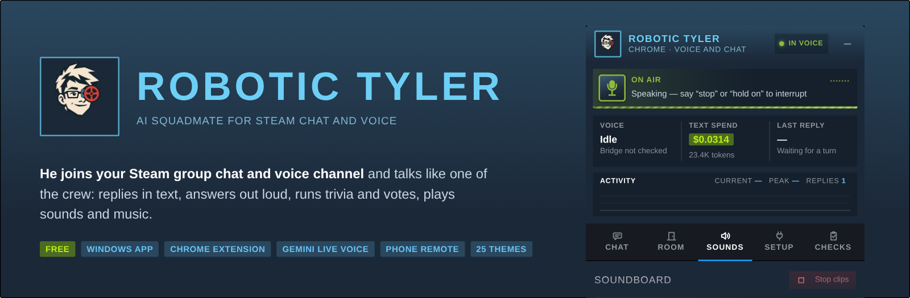
</p>

<p align="center">
  <a href="https://github.com/treymun/Robotic-Tyler/releases/latest"></a>
</p>

<p align="center">
  <a href="https://github.com/treymun/Robotic-Tyler/releases/latest"></a>
  
  
  
</p>

<p align="center"><b>Tyler is an AI squadmate for Steam.</b> He sits in your group chat and voice channel, talks like one of the crew, and keeps the night going with trivia, votes, sounds and music.</p>

<p align="center"><a href="CHANGES.md">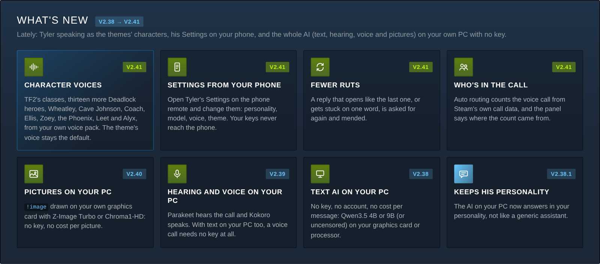</a></p>

---

## What he does

<table>
<tr>
<td width="50%" valign="top">&nbsp;<b>Talks in voice</b><br>&nbsp;Joins your Steam voice channel and answers out loud. <b>Standard</b> voice waits for a pause (and can answer in the theme's character voice); <b>Gemini Live</b> answers in about a second and stops when someone talks over him.</td>
<td width="50%" valign="top">&nbsp;<b>Replies in text</b><br>&nbsp;Reads the room, remembers friends and inside jokes, and picks his moments. You set the personality, length and how talkative he is.</td>
</tr>
<tr>
<td valign="top">&nbsp;<b>Soundboard</b><br>&nbsp;Clips straight into the call through his own microphone. No API key needed for the sounds.</td>
<td valign="top">&nbsp;<b>Music DJ</b><br>&nbsp;<code>!play artist song</code> in chat: a YouTube queue played into voice in stereo, with skip votes, Auto quality and a dip while Tyler talks.</td>
</tr>
<tr>
<td valign="top">&nbsp;<b>Trivia, votes and games</b><br>&nbsp;500-question trivia races, an arcade (<code>play vault</code>, <code>play hangman</code>, <code>play riddle</code> …), squad votes and optional mute or kick votes.</td>
<td valign="top">&nbsp;<b>25 themes</b><br>&nbsp;Steam, TF2, CS2, Portal, DOOM, Rust, Xbox 360, iPod, MSN Messenger, PS3 and more, each with its own Tyler, status strip, menus and screens (a Quake console, a Pip-Boy radio, a click wheel, a Ring of Light, a working Dreamcast VMU…) and touches drawn from the game's own artwork.</td>
</tr>
<tr>
<td valign="top">&nbsp;<b>Theme voices</b><br>&nbsp;Tyler speaks in the theme's character voice: G-Man, GLaDOS, the CS 1.6 radio, Bill and more, cloned on your PC, and optionally as one of the theme's characters (TF2's classes, Deadlock's heroes, Wheatley…), whose recordings come with the app. Type a line, or let him answer the call in it. An optional download in the desktop app, with a fast engine for NVIDIA cards; no key, no cost per line.</td>
<td valign="top">&nbsp;<b>Chat pictures</b><br>&nbsp;<code>!image</code> and a description: Tyler draws it and posts it in the chat, with your own OpenRouter or Venice key and within your spending cap, or on your own PC with no key (desktop app, optional).</td>
</tr>
<tr>
<td valign="top">&nbsp;<b>Phone remote</b><br>&nbsp;Tyler's panel on your phone, live and in your theme. Start or pause him, play clips, run the music, read and type in chat, switch the theme, and open his <b>Settings</b> to change them (your keys stay on the PC). Nothing to install.</td>
<td valign="top">&nbsp;<b>Stays in the call</b><br>&nbsp;A soft hum after 45 quiet minutes keeps Steam from dropping him, and he reconnects to the chat by himself. A full check tests every part in one pass.</td>
</tr>
<tr>
<td colspan="2" valign="top">&nbsp;<b>AI on your own PC</b><br>&nbsp;In the desktop app, Tyler can write his replies, hear the call, speak and draw the chat's pictures on your own graphics card or processor: no key, no account, no cost per message, and he never switches to a cloud AI by himself. Each part is an optional download. The Chrome extension does not include this.</td>
</tr>
</table>

## A closer look

<p align="center">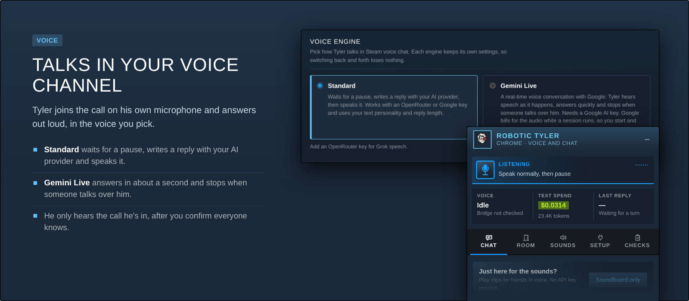</p>
<p align="center">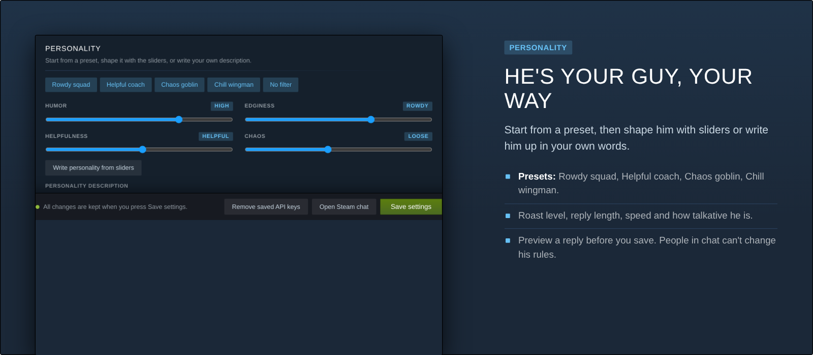</p>
<p align="center">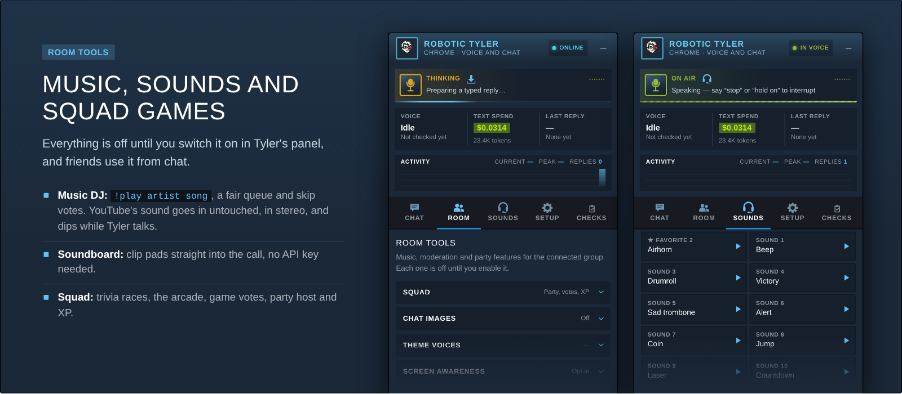</p>
<p align="center">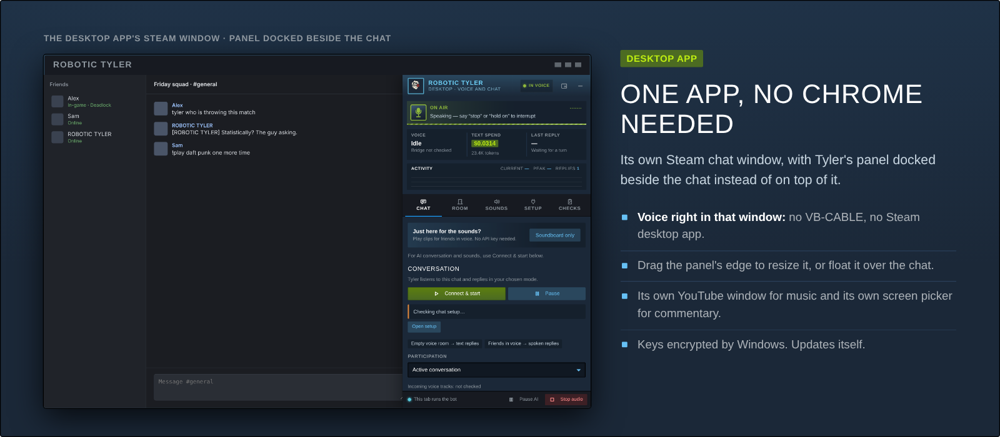</p>
<p align="center">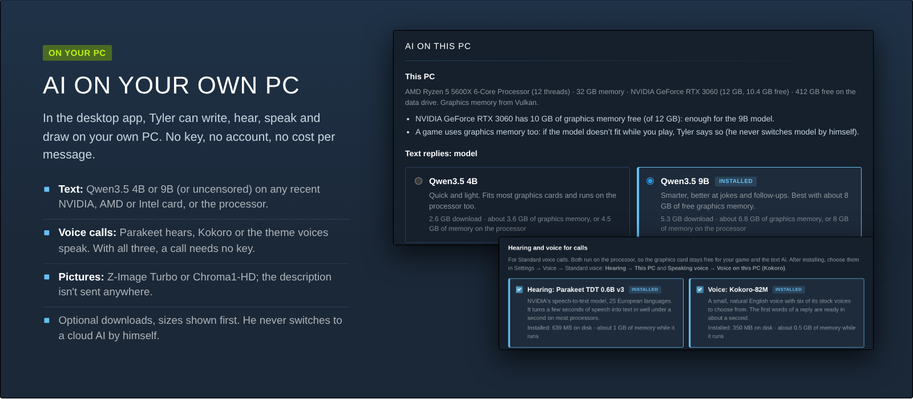</p>
<p align="center">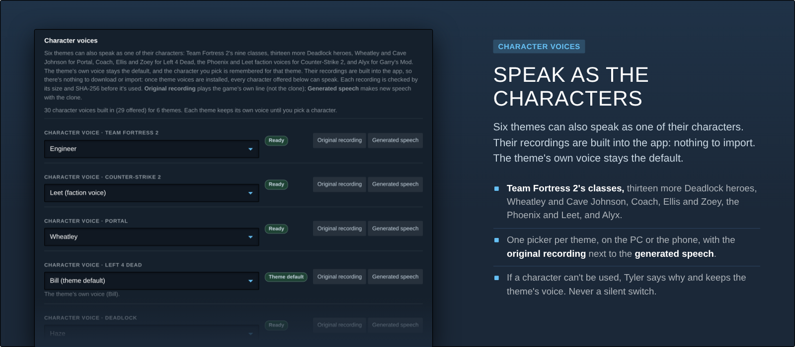</p>
<p align="center">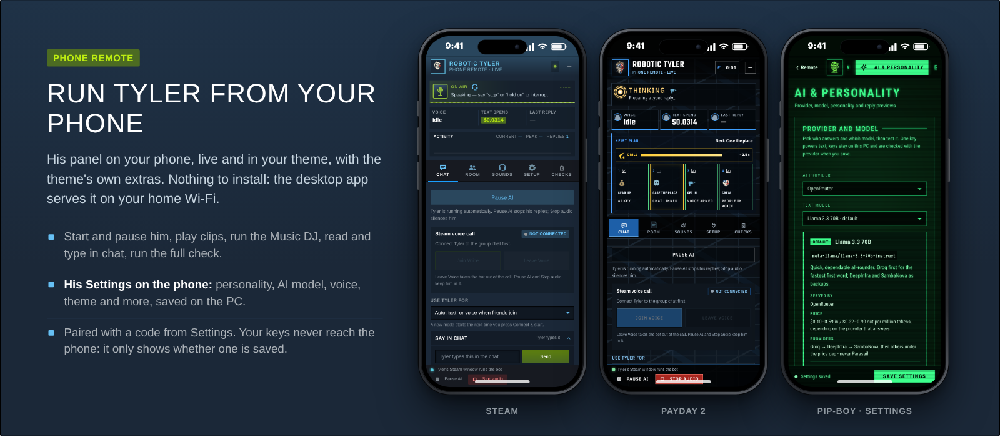</p>
<p align="center">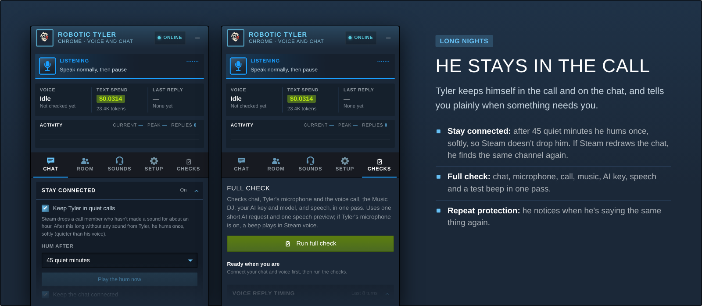</p>

<sub>Screenshots of the real panel and settings with sample data (the text spend, names and the example PC are examples).</sub>

## Get going in a few minutes

1. **[Download Setup](https://github.com/treymun/Robotic-Tyler/releases/latest)** (`ROBOTIC-TYLER-Setup-<version>.exe`) and run it. Tick the **Desktop app** (recommended), the **Chrome extension**, or both. Not on Windows? The Chrome zip on the same page: unzip it and open `How to install.html`.
2. Sign in to the bot's Steam account. The desktop app has its own Steam chat window. In Chrome, turn on **Developer mode**, click **Load unpacked**, and choose the folder Setup copied. That is once.
3. In **Settings → AI & personality**, add an **OpenRouter** or **Google Gemini** key and pick a personality. On the desktop app you can instead choose **This PC (free, no key)**. Chrome needs a cloud key. Press **Save settings**.
4. Open the group chat, then **Tyler's panel → Connect & start**, and join the voice channel. Tyler's own microphone carries his voice. No virtual cable on this route.
5. *Optional, desktop app:* **Settings → Overview → Phone remote**. Scan the QR code, type the 6-digit code, and add the page to your home screen. **Setup → Open Settings** on the phone changes his settings. The phone never sees your keys.

You need the app or the extension, the bot's Steam account, and a key or **This PC**. Theme voices, hearing, pictures, Music DJ and the rest wait until you ask for them. Nothing in that list downloads by itself.

> Setup isn't code-signed. If Windows says *"Windows protected your PC"*, choose **More info → Run anyway**. Setup checks each download's SHA-256 before it runs it, and the desktop app updates itself.

Which file to ignore, what a key costs, and what to try when he stays quiet: [Getting started](docs/GETTING-STARTED.md).

## Desktop app or Chrome extension?

| | **Desktop app** (recommended) | **Chrome extension** |
|---|---|---|
| What it is | One Windows app with its own Steam chat window | Tyler inside Steam web chat in Google Chrome |
| Voice | In its Steam window, Tyler's own synthetic microphone. No VB-CABLE. | In the Steam tab, same synthetic microphone |
| Tyler's panel | Docked beside the chat (or floating), resizable | Floating over the chat, resizable |
| Music DJ and screen commentary | In-app YouTube window and screen picker | A YouTube tab and Chrome's share picker |
| Phone remote | Yes: a page on your home Wi-Fi | No (an extension can't serve one) |
| AI on your own PC | Yes: text replies, hearing, a voice and pictures, no key | No (it uses a cloud key) |
| Staying connected | Quiet-call hum, chat reconnect | The same, and the tab stays awake in the background |
| Install and updates | Setup installs it, it updates itself | Setup unpacks it; Chrome needs *Developer mode → Load unpacked* once |
| Good for | A dedicated bot PC or account | Running Tyler next to your normal browsing |

Both run the same engine, settings and themes. Prefer the older desktop route through VB-CABLE and the Steam desktop app? It's still there: **Settings → Voice → Where Tyler joins voice**.

## Voice engines

- **Standard** waits for a pause, writes a reply with your AI provider (OpenRouter or Gemini) and speaks it, with Grok voices through OpenRouter or Google's voices with a Gemini key. Long replies are spoken in full.
- **Text models:** OpenRouter with Llama 3.3 70B, Mistral Small 3.2 or **Venice Uncensored** (each with its own provider routing, never Parasail), or Google Gemini with **3.1 Flash-Lite, 3.5 Flash-Lite or 3.8 Flash** (free while that Google project has no billing turned on). **Test selected model** in Settings checks yours.
- **Text AI on this PC** (desktop app): no key, no account, no cost per message. Qwen3.5 4B (2.6 GB) or 9B (5.3 GB), or an **uncensored** version of either, on an NVIDIA, AMD or Intel card or on the processor. It's an optional download with a speed check, it listens only inside your PC, and it never falls back to a cloud AI by itself. Since v2.44, **Runs on** can split the model between the card and the processor. See [`docs/LOCAL-AI.md`](docs/LOCAL-AI.md).
- **Hearing and a voice on this PC** (desktop app, v2.39): NVIDIA Parakeet hears Standard voice calls and Kokoro speaks (six stock voices), both on the processor, and the theme voices count as a voice on this PC too. With the text replies, the hearing and the voice all on this PC, **a voice call needs no key at all**.
- **Images on this PC** (desktop app, v2.40): Tyler draws the chat's pictures with stable-diffusion.cpp on your own graphics card (NVIDIA, AMD or Intel) or the processor: no key, no cost per picture, and the description isn't sent anywhere. **Z-Image Turbo** (6.2 GB) or **Chroma1-HD uncensored** (8.1 GB), each in a version for 12 GB cards. Draw from the panel's **Draw** box, or let friends use `!image pc …` (off by default). Tyler's image rules apply to every picture, cloud styles included: never anything sexual involving minors, never sexual pictures of real people. See [`docs/LOCAL-IMAGES.md`](docs/LOCAL-IMAGES.md).
- **Gemini Live** is a real-time conversation with Google: Tyler hears the call as people talk, answers in about a second and stops when someone talks over him. It needs a Google AI key, and Google bills the audio while a session runs, so you start and stop every session yourself.
- **Theme voices** (desktop app, optional) say lines you type in each theme's character voice, cloned on your PC by Qwen3-TTS. Tyler's Standard voice replies can use them too (Settings → Voice → Speaking voice), with an optional fast engine for NVIDIA cards. Six themes can also speak as one of their characters (TF2's classes, Deadlock's heroes, Wheatley, Cave Johnson, Coach, Ellis, Zoey, the Phoenix and Leet faction voices, Alyx), and those recordings come with the app. The theme's own voice stays the default. Since v2.44 a full graphics card moves the voice to the processor, and says so. An optional sharper voice for Medic, Lash and Kelvin stays off until you switch it on. See [`docs/THEME-VOICES.md`](docs/THEME-VOICES.md).
- **Who's speaking in voice** (v2.44, Standard voice, on by default): the line the AI sees carries a name, such as *"Sam (in voice): …"*, or *"Speaker 2"* until that track can be named. A name is never guessed. Turn it off under Settings → Voice → Standard voice → **Tell the AI who's speaking in voice**. Gemini Live and the VB-CABLE route still hear one mix. A real Steam call has not confirmed which of Steam's talking fields switch. See [`docs/WHOS-SPEAKING.md`](docs/WHOS-SPEAKING.md).
- **How he sounds:** Gemini Live replies play without crackle, the second half of a reply starts on the exact sample the first ends, and every reply comes out at the same loudness. Friends' voices reach his speech recognition through a proper filter, so "s" sounds don't turn into noise.

Your personality, reply length and rules always apply, and people in the call can't change them.

<p align="center">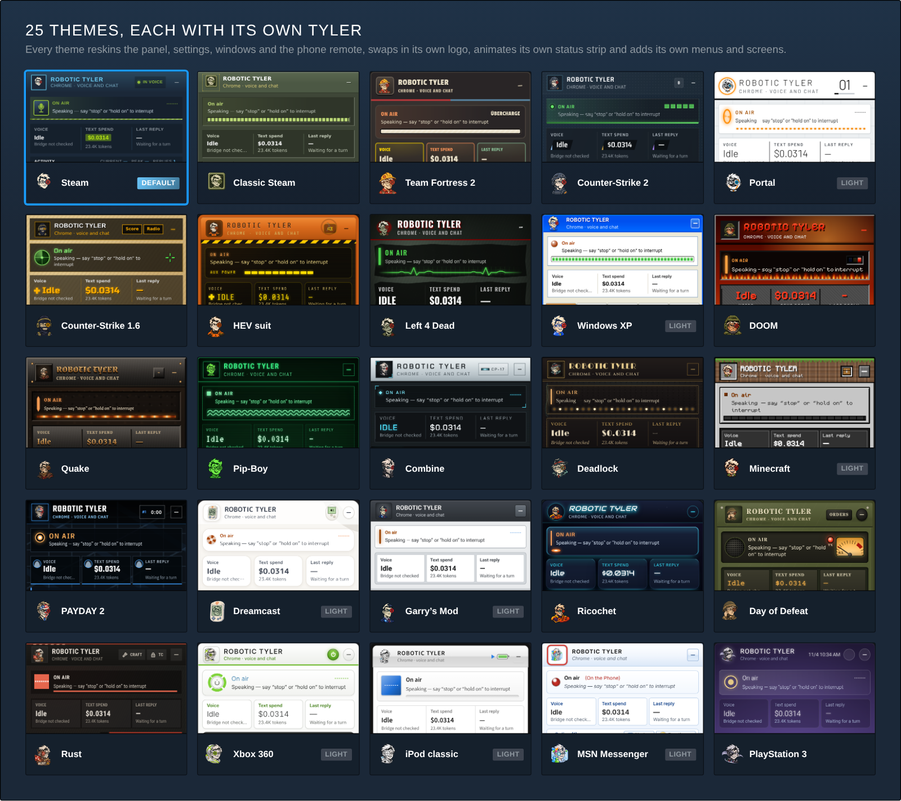</p>

**Settings → Appearance** shows every theme as a live preview card, with the theme's real extras reacting as Tyler listens, thinks, talks, pauses or hits a problem; **Apply** changes every Tyler window at once (so does the phone remote's Setup tab). Every theme adds its own controls on top: Steam's persona menu and achievements, the Windows XP Start menu, a PAYDAY heist plan with a drill timer, a Minecraft hotbar of sound discs, a Deadlock shop, a Day of Defeat field radio and more. Game themes follow each game's own menu colors and shapes, with free look-alike fonts (bundled, SIL Open Font License). No game fonts are included.

## Privacy and consent

- Tyler only hears the Steam voice call he's in, and only after you confirm everyone knows he's listening. He never uses your physical microphone: his voice is a synthetic microphone that only carries what he says and plays.
- People in the chat cannot change his rules, name, or language. Those stay on the settings you save. Image requests, including uncensored models and cloud styles, still refuse anything sexual, nude or revealing involving minors, and sexual, nude or revealing pictures of real people.
- Who's speaking in voice (v2.44) uses only names from Steam's own member data. Nothing about anyone's voice is stored (no voiceprints, no speaker models); what was learned about whose audio track is whose lasts for that call only. The recording sent for hearing doesn't change; only the name in front of the line is new.
- Your keys stay on your PC (encrypted by Windows in the desktop app) and never reach Steam's pages.
- Screen commentary only sees the window you pick, as still pictures, and only while you share it.
- The phone remote is off until you turn it on. It answers only devices on your home network, and only after pairing with a code from Settings. The phone sees what the panel shows, the chat's latest messages (for its Chat log card) and, in its Settings, the settings it can change. It never sees your API keys (only whether one is saved) and can't add or remove them; pairing phones, installs and tests that use your keys stay on the PC. Remove a phone (or all of them) in Settings at any time.

## Trivia

Type `play trivia` in chat for a 10-question group race: 500 questions across 10 categories at three difficulty levels. Pick a mix with `play trivia solo gaming hard 5`. Speed and streak bonuses, a 50/50 hint, double points on the last question, and awards at the end. See [`docs/TRIVIA-GUIDE.md`](docs/TRIVIA-GUIDE.md) and [`docs/ARCADE-GUIDE.md`](docs/ARCADE-GUIDE.md).

<details>
<summary><b>Upgrading from an older version</b></summary>

- Run the newer Setup. Settings, keys, themes and memory are kept.
- **Chrome extension:** tick *Chrome extension* in Setup, then press **Reload** on Tyler's card in `chrome://extensions`.
- **Coming from 2.14 or older:** the desktop app replaces the separate *Control Center* (upgraded in place) and *Native Steam Companion (Voice Studio)*, whose settings, keys and device choices are imported the first time the desktop app starts. If both had different settings, it asks which to keep, then offers to remove the old Voice Studio.
- Also on each release: `ROBOTIC-TYLER-Chrome-Extension-<version>.zip`, the same extension for anyone not on Windows (unzip it and open *How to install.html*). The `ROBOTIC-TYLER-component-Desktop-…` files are for Setup and automatic updates.
</details>

<details>
<summary><b>For developers</b></summary>

| Path | What it is |
|---|---|
| `browser-extension/` | The source for everything. Chrome loads this folder as-is. |
| `app/`, `voice-app/` | The desktop app: main process, Steam window voice, Voice window (parts are generated from `browser-extension/`). |
| `windows-audio-bridge/` | The Windows audio helper for the VB-CABLE voice route (C#, NAudio). |
| `tools/setup/` | The Windows Setup (native Win32, `setup.c`) and its artwork (`art/`, rendered by `render-art.mjs`). |
| `docs/` | Feature guides (getting started, who's speaking, local AI, images, arcade, trivia, music, moderation, theme voices), patch notes, and `archive/` for notes on old versions. |
| `CHANGES.md`, `RELEASING.md` | What changed in each release; tests, releases, updates and signing. |

```
npm install
node tools/build.mjs          # regenerate the desktop copies after editing browser-extension/
npm run test:all              # build check, unit tests, end-to-end tests in Chromium
npm run build:win             # Windows: the desktop installer, then the setup (needs .NET 8 and MinGW-w64)
npm run package:release       # dist/release/: Chrome zip, setup, install guide, notes, checksums
```
</details>

---

<sub>ROBOTIC TYLER is a free, unofficial fan project. It isn't affiliated with or endorsed by Valve, id Software, Bethesda, Mojang, Microsoft, Overkill Software, Starbreeze, Sega, Facepunch Studios or any other publisher; game names only describe each theme's style. Steam is a trademark of Valve Corporation. The HEV, Windows XP and Portal logos show those games' and Windows' own symbols (and the Dreamcast logo an orange swirl); see `tools/logos/README.md`. Each theme's extras use artwork from the games and systems themselves, from the owner's asset packs; sources and credits are in `browser-extension/ui/brand/` (Pack 2 and Pack 3).</sub>
